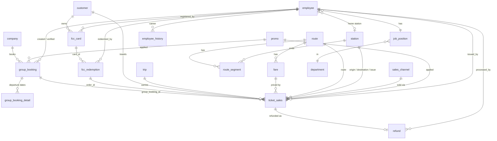

# hst-synthetic-dataset

Synthetic ticketing dataset for a fictional high-speed train (HST) operator, built for machine learning and analytics practice. All people, companies, bank accounts and IDs are generated. Nothing here is real operational data.

> Status: design done (docs and DDL). Generator not written yet.

## Goals

- About 9.2 million ticket rows (`ticket_sales`) between 2020 and 2025, from all sales channels. 2025 averages 200,000 tickets per month.
- Group travel is a random 15 to 35 percent of tickets each month. A group has at least 20 passengers.
- Demand that follows real-world patterns: COVID collapse and recovery, Lebaran peaks, Christmas and New Year, school holidays, weekends, limited by trip capacity.
- Pricing and discounts that react to demand: crowded periods get small discounts, quiet periods larger ones, groups get tiered discounts, and random promos run each month (for example a "February Deals" offer of 20 percent for groups of at least 20 passengers).
- Repeat customers (commuters, occasional, one-time) so churn and frequency can be modelled.
- Employees with position, NIP and history, linked to the tickets they issue, the bookings they handle, the cards they register and the refunds they process.
- Tickets with status and refunds, trips with capacity, fares by route and class.
- A pure dataset for PostgreSQL: one operational schema (`oltp`), plus a separate schema (`oltp_truth`) with answer keys for ML labels and checks. Downstream modelling and ETL are out of scope of this repo.
- Everything is in English (tables, columns, values, messages). Only generated person and company names are Indonesian.

The timeline is fictional: the operator is assumed to run since 2020, at a deliberately smaller scale than any real railway. Do not present the data as real figures.

## Source schemas

The operational layer extends two existing Laravel apps. Source-to-new names are in [docs/column-mapping.md](docs/column-mapping.md).

| Source | Tables | Role |
|---|---|---|
| group-ticket verification app | `dokumen_bak`, `dokumen_bak_detail`, `data_ticketsales`, `dokumen_rekeningkoran` | group bookings, tickets, bank statement |
| frequent card admin app | `maindata` (cards), `subdata` (redemptions) | frequent customer card (FCC) and quota redemption |

New in this dataset: employees (`employee`, `employee_history`, `job_position`, `department`), `station`, `route_segment`, `fare`, `trip`, `sales_channel`, `promo`, `refund`, `company`, `customer`, calendar tables, and the answer keys in schema `oltp_truth` (`customer_truth`, `ticket_group_truth`, `group_booking_payment`, `anomaly_label`).

## Entity relations



Reading guide: a group booking groups tickets and is paid through one or more bank lines (a line can pay several bookings; the true allocation is an answer key). A card redemption produces a ticket with the same `order_id`. Staffed channels record the issuing employee and station; self-service channels leave them empty. The `oltp_truth` tables are left out of the diagram.

## Frequent card rules (from the source app)

| Type | Quota | Validity |
|---|---|---|
| G | 10 | 60 days |
| S | 6 | 30 days |

Route codes: `01` Jakarta to Bandung, `02` Jakarta to Karawang, `03` Karawang to Bandung. A redemption is only valid while quota remains and the card is not expired.

## Demand model

```
daily volume = baseline x yearly trend x seasonality x event effect x noise
```

Lebaran dates used: 2020-05-24, 2021-05-13, 2022-05-02, 2023-04-22, 2024-04-10, 2025-03-31. Full rules are in [docs/design.md](docs/design.md).

## Planned size

| Entity | Approx. rows |
|---|---|
| tickets | about 9.2 million |
| group tickets | 15 to 35 percent per month |
| group bookings | 40,000 to 70,000 |
| trips | 25,000 to 45,000 |
| bank statement lines | 100,000 to 200,000 |
| customers | 1,000,000 to 2,000,000 |
| frequent cards | 200,000 to 400,000 |
| employees | 400 to 600 over the period |

## ML and BI targets

Seven tasks with label, features, time split and metric are defined in [docs/ml-targets.md](docs/ml-targets.md): demand forecasting, discount prediction, customer churn, late payment, payment matching, group ticket classification and anomaly detection.

## Output

- PostgreSQL DDL, reference data and comments (`sql/01` to `sql/04`), and `.sql` load scripts.
- `.csv` per table.
- Target: shared PostgreSQL server, schemas `oltp` and `oltp_truth`. Downstream pipelines read `oltp` only.

## Roadmap

1. Design document and PostgreSQL DDL. Done: see [docs/design.md](docs/design.md), [docs/tables.md](docs/tables.md), [docs/data-dictionary.md](docs/data-dictionary.md), [docs/ml-targets.md](docs/ml-targets.md) and `sql/`.
2. Python generator with a fixed random seed, so runs are reproducible.
3. Validation checks (quota, expiry, payment totals against booking totals).
4. Load into the shared PostgreSQL server.

## License

MIT, see [LICENSE](LICENSE).
