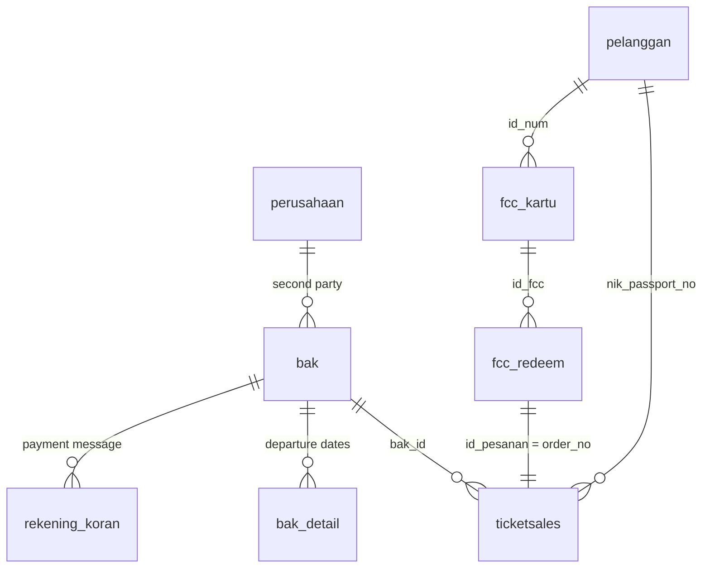

# hst-synthetic-dataset

Synthetic ticketing dataset for a fictional high-speed train (HST) operator, built for machine learning and data warehouse / BI practice. All people, companies, bank accounts and IDs are generated. Nothing here is real operational data.

> Status: design done (docs and DDL). Generator not written yet.

## Goals

- About 1,000,000 ticket rows (`data_ticketsales`) between 2020 and 2025.
- Demand that follows real-world patterns: COVID collapse and recovery, Lebaran peaks, Christmas and New Year, school holidays, weekends.
- Pricing and discounts that react to demand: crowded periods get small discounts, quiet periods get larger ones, groups get tiered discounts, and one fictional company anniversary promo runs each year.
- Repeat customers (commuters, occasional, one-off) so churn and frequency can be modelled.
- Two layers: an operational schema (OLTP) and a star schema (DWH), both for PostgreSQL.

The timeline is fictional: the operator is assumed to run since 2020. Do not present the data as real figures of any actual railway.

## Source schemas

The operational layer extends two existing Laravel apps.

| Source | Tables | Role |
|---|---|---|
| group-ticket verification app | `dokumen_bak`, `dokumen_bak_detail`, `data_ticketsales`, `dokumen_rekeningkoran` | group bookings (BAK), tickets, bank statement |
| frequent card admin app | `maindata` (cards), `subdata` (redeems) | frequent customer card (FCC) and quota redemption |

Changes from the sources:

- Bank statement becomes transaction level: date, account number, credit or debit, amount, counterparty name, counterparty account, bank, message, balance.
- BAK gains passenger count, total value, total discount and route.
- Ticket dates become real `date` columns, and price is split into base price, discount, tax and final price.
- New master tables: `pelanggan` (person) and `perusahaan` (fictional company, the second party of a BAK and the sender in the bank statement).

## Planned entity relations



Reading guide: a BAK groups tickets and is paid through one or more bank statement lines. A frequent card redeem produces a ticket order with the same order number.

## Frequent card rules (from the source app)

| Type | Quota | Validity |
|---|---|---|
| G | 10 | 60 days |
| S | 6 | 30 days |

Route codes: `01` Jakarta to Bandung, `02` Jakarta to Karawang, `03` Karawang to Bandung. A redeem is only valid while quota remains and the card is not expired.

## Demand model

```
daily volume = baseline x yearly trend x seasonality x event effect x noise
```

Lebaran dates used: 2020-05-24, 2021-05-13, 2022-05-02, 2023-04-22, 2024-04-10, 2025-03-31.

## Planned size

| Entity | Approx. rows |
|---|---|
| tickets | 1,000,000 |
| BAK | 20,000 to 30,000 |
| bank statement lines | 40,000 to 60,000 |
| customers | 150,000 to 250,000 |
| frequent cards | 30,000 to 50,000 |

## ML and BI targets

- Daily demand per route.
- Discount amount.
- Customer churn and visit frequency.
- Late or short payment of a BAK.
- Injected anomalies (underpayment, duplicates, name mismatch), marked by a label column.

## Output

- PostgreSQL DDL and `.sql` load scripts.
- `.csv` per table.
- Target: shared PostgreSQL server, schemas `oltp` and `dwh`.

## Roadmap

1. Design document and PostgreSQL DDL (OLTP and DWH). Done: see [docs/design.md](docs/design.md), [docs/tables.md](docs/tables.md) and `sql/`.
2. Python generator with a fixed random seed, so runs are reproducible.
3. Validation checks (quota, expiry, payment totals against BAK totals).
4. Load into the shared PostgreSQL server.

## License

MIT, see [LICENSE](LICENSE).
