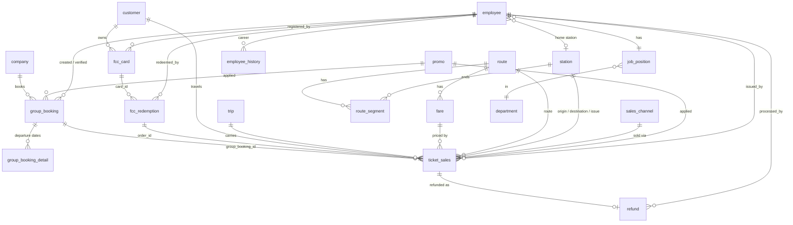

# HST Synthetic Dataset

[](https://github.com/samsmon/hst-synthetic-dataset/releases/tag/v0.3.0)
[-orange)](docs/dwbi-guide.md)
[](https://github.com/samsmon/hst-synthetic-dataset/releases/tag/v0.3.0)
[](sql/)
[](generator/tests/)
[](sql/05_checks.sql)
[](LICENSE)

An enterprise-scale relational and dimensional synthetic dataset modelling 6 full operating years (2020 through 2025) of high-speed passenger rail operations on the Jakarta–Bandung corridor. 

Designed specifically for **DWBI coursework, machine learning benchmarks, analytics engineering, fraud & anomaly detection, and database stress testing**, this repository packages over **18 million records** across 17 relational database tables and a single denormalized **10.8M ticket analytics mart**, complete with realistic economic shocks, directional holiday rushes, commuter rhythms, and segregated ground-truth keys.

> All passengers, corporate entities, bank accounts, NIKs, and employee identities are synthetically generated. Nothing here contains real-world operational or private data.

---

## Download & Quickstart

Pre-packaged release assets are available on [GitHub Releases](https://github.com/samsmon/hst-synthetic-dataset/releases):

### 1. Analytics Wide Mart (`v0.3.0` — Recommended for DWBI & Dashboards)

Denormalized star-schema dataset joining 10.8M ticket sales with customers, trips, promos, corporate bookings, FCC loyalty cards, and refund measures. Complete documentation in the **[DWBI Guide](docs/dwbi-guide.md)**.

| Asset | Format | Size | SHA256 | Description |
|---|---|---|---|---|
| **[`hst_analytics_wide_v0.3.0.parquet`](https://github.com/samsmon/hst-synthetic-dataset/releases/download/v0.3.0/hst_analytics_wide_v0.3.0.parquet)** | Parquet (ZSTD) | 220 MB | `6ffd096975dbcedf...` | Columnar format optimized for DuckDB, Power BI, Tableau, Polars, and Pandas |
| **[`hst_analytics_wide_v0.3.0.csv.gz`](https://github.com/samsmon/hst-synthetic-dataset/releases/download/v0.3.0/hst_analytics_wide_v0.3.0.csv.gz)** | CSV (GZIP) | 394 MB | `7238827827cc6ca8...` | Universal compressed CSV for PostgreSQL COPY, BigQuery, Snowflake, and Excel |
| **[`checksums.txt`](https://github.com/samsmon/hst-synthetic-dataset/releases/download/v0.3.0/checksums.txt)** | Text | 148 B | — | SHA256 hashes for download verification |

Query 10.8M rows in seconds with DuckDB:
```python
import duckdb

# Sub-second analytical query directly over Parquet
duckdb.sql("""
SELECT 
    season_type,
    travel_direction,
    time_slot,
    COUNT(*) AS total_tickets,
    ROUND(SUM(net_revenue) / 1e9, 2) AS net_revenue_billion_idr
FROM 'hst_analytics_wide_v0.3.0.parquet'
WHERE ticket_status = 'used'
GROUP BY 1, 2, 3
ORDER BY 4 DESC
LIMIT 10;
""").show()
```

### 2. Normalized Relational Database (`v0.2.0`)

Full 17-table relational schema partitioned into operational (`oltp`) and evaluation (`oltp_truth`) layers:

| Asset | Size | SHA256 | Description |
|---|---|---|---|
| **[`hst_dataset_csv_v0.2.0.tar.gz`](https://github.com/samsmon/hst-synthetic-dataset/releases/download/v0.2.0/hst_dataset_csv_v0.2.0.tar.gz)** | 644 MB | `2cee9d4c6400379b...` | 20 CSV files partitioned by schema (`oltp/`, `oltp_truth/`, `reference/`) |
| **[`hst_dataset_postgres_v0.2.0.sql.gz`](https://github.com/samsmon/hst-synthetic-dataset/releases/download/v0.2.0/hst_dataset_postgres_v0.2.0.sql.gz)** | 651 MB | `bd49de2bb7b1787d...` | All-in-one PostgreSQL dump (DDL, constraints, table comments, and COPY data) |

#### One-Line Restore to PostgreSQL

```bash
# Create target database
createdb -h localhost -p 5432 -U postgres hst_dataset

# Stream decompression directly into psql
gunzip -c hst_dataset_postgres_v0.2.0.sql.gz | psql -h localhost -p 5432 -U postgres -d hst_dataset
```

### 2. Direct CSV Exploration (DuckDB / Polars / Pandas)

```bash
# Extract structured CSV directory
tar -xzf hst_dataset_csv_v0.2.0.tar.gz
```

Query with DuckDB in seconds:
```sql
-- Query 10.8M ticket sales directly from CSV
SELECT 
    origin_station_id, 
    destination_station_id, 
    date_part('year', travel_date) AS yr, 
    COUNT(*) AS total_tickets,
    AVG(total_price) AS avg_fare
FROM read_csv_auto('hst_dataset_csv/oltp/ticket_sales.csv')
GROUP BY 1, 2, 3
ORDER BY yr, total_tickets DESC;
```

---

## Dataset Schema & Table Matrix

The dataset spans 2,192 operating days (2020-01-01 to 2025-12-31) and is split into two PostgreSQL schemas:
1. **`oltp`**: Operational schema capturing ticketing transactions, group reservations, Frequent Customer Cards (FCC), refunds, workforce, and bank statements.
2. **`oltp_truth`**: Segregated evaluation layer containing ground-truth labels for customer segmentation, true booking links, ledger matches, and injected anomalies.

| Schema | Table / File | Rows | CSV Size | Description |
|---|---|---|---|---|
| `oltp` | `ticket_sales` | 10,815,864 | 2.38 GB | Complete individual and group ticket sales across 6 channels |
| `oltp` | `customer` | 2,554,016 | 301.05 MB | Master passenger identities with synthetic NIKs and demographics |
| `oltp` | `fcc_redemption` | 1,022,908 | 74.04 MB | Subscription card quota redemption ledger |
| `oltp` | `bank_statement` | 224,071 | 24.44 MB | Operational bank account ledger (TRF, SETTLE, REFUND, FEE, INT) |
| `oltp` | `refund` | 152,037 | 8.03 MB | Processed cancellations, retention fees, and reason codes |
| `oltp` | `fcc_card` | 128,944 | 7.46 MB | Frequent Customer Cards issued (Gold 50-trip & Silver 20-trip) |
| `oltp` | `group_booking_detail` | 64,472 | 1.45 MB | Outbound and return travel legs per group contract |
| `oltp` | `group_booking` | 48,562 | 9.30 MB | Group reservation contracts, quotation statuses, and pax counts |
| `oltp` | `trip` | 34,113 | 1.88 MB | Scheduled train services with train capacities and load factors |
| `oltp` | `company` | 4,000 | 277.81 KB | Registered corporate clients, travel agencies, and institutions |
| `oltp` | `employee_history` | 732 | 20.78 KB | Station transfers, promotions, and career progressions |
| `oltp` | `employee` | 612 | 79.14 KB | Operations, customer service, and ticketing workforce |
| `oltp` | `promo` | 90 | 8.35 KB | Seasonal, anniversary, and targeted discount campaigns |
| `oltp_truth` | `customer_truth` | 2,554,016 | 47.08 MB | Generator segments (`commuter`, `occasional`, `one_time`), churn flags |
| `oltp_truth` | `ticket_group_truth` | 110,525 | 1.64 MB | Ground-truth mapping of individual group passengers to bookings |
| `oltp_truth` | `group_booking_payment` | 70,050 | 2.04 MB | Exact ledger allocation linking bank credits to group bookings |
| `oltp_truth` | `anomaly_label` | 58,676 | 2.41 MB | Ground truth benchmark labels for 7 anomaly classes |
| `reference` | `stage1_demand.csv` | 6,576 | 172.35 KB | Route-level daily passenger baseline demand curves |
| `reference` | `trip_hidden.csv` | 34,113 | 744.39 KB | Planned capacity seeds and target load factors |
| `reference` | `company_hidden.csv` | 4,000 | 241.89 KB | Latent booking propensities and payment promptness scores |
| **Total** | **All 20 CSV files** | **17,888,377** | **2.85 GB** | Full dataset volume |

---

## Entity-Relationship Architecture



---

## Realistic Corridor Dynamics & Economic Shocks

The dataset models authentic passenger travel behavior on the Jakarta–Bandung corridor:

1. **COVID-19 Shock & 2020 Refund Surge**: Passenger volumes dropped from ~2,300/day to <950/day in March 2020. Refund rates surged to 15–25% between March and June 2020, with 100% cancellation fee waivers for passengers citing `schedule_change`.
2. **Mudik Bans & Delta Wave Plunge**: Nationwide *Larangan Mudik* in 2020 and 2021 suppressed holiday travel (<350 tickets/day during Lebaran 2020). The July 2021 Delta variant outbreak (PPKM Darurat) dropped volume to 24% of normal capacity.
3. **Asymmetric Mudik Lebaran Rush (2022–2025)**: 
   - **Pre-Eid (H-7 to H-1)**: Outbound departures (Halim $\to$ Bandung) surge by **+60%** (peaking at H-3).
   - **Eid Day (1 Shawwal)**: Severe mid-holiday trough as passengers remain home.
   - **Return Rush (H+3 to H+7)**: Inbound trains returning to Jakarta swell by **+50%** (peaking around H+5).
   - **All-Time Peak Day**: **April 7, 2024 (H-3 Lebaran 1445 H)** with **14,796 passengers** across 45 daily trips.
4. **Year-End Double Peaks**: Dual surges every December: Christmas travel peaking on **December 24–25** and New Year's Eve peaking on **December 31–January 1** (>8,500 pax/day).
5. **Weekly Commuter Rhythm**: Friday afternoon outbound travel surges **+25%** as office workers leave Jakarta for Bandung, followed by a Sunday evening return spike of **+15%**.
6. **Commuter Economy (FCC Cards)**: 128,944 subscription cards issued (Gold 50-trip / 6 months; Silver 20-trip / 3 months), driving 1,022,908 quota boardings.
7. **Corporate Settlement Behaviors**: Travel agencies settle full invoices promptly within 2–5 days; government entities and schools follow longer bureaucratic multi-installment payment schedules.
8. **58,676 Injected Operational & Financial Anomalies**:
   - `date_outlier` (23,677): Travel or issuance dates violating operating calendar constraints.
   - `duplicate_ticket` (16,888): Duplicate seat issuances on digital channels.
   - `inactive_issuer` (15,236): Tickets issued by employees outside active shift/tenure dates.
   - `name_mismatch` (1,022): Bank transfer sender names mismatched with legal entity names.
   - `underpayment` (699): Partial bank transfers falling short of contracted totals.
   - `duplicate_payment` (688): Redundant bank wire transfers.
   - `overpayment` (466): Bank transfers exceeding contract totals.

---

## Machine Learning & Benchmark Tasks

Detailed problem formulations, feature sets, train/test splits, and baseline metrics are documented in [docs/ml-targets.md](docs/ml-targets.md):

| Task ID | Domain | Formulation | Target Column | Split Strategy |
|---|---|---|---|---|
| **ML-1** | Demand Forecasting | Time-Series Regression | Daily ticket sales by route | Temporal (Train: 2020–2024, Test: 2025) |
| **ML-2** | Dynamic Pricing | Regression | `discount_amount` | Temporal / Stratified by demand phase |
| **ML-3** | Customer Churn | Binary Classification | Churned within 90 days | Temporal cohort (Train: 2020–2024, Test: 2025) |
| **ML-4** | Corporate Late Payment | Ordinal Classification | Settlement delay tier | Time split by contract signature |
| **ML-5** | Bank-to-Invoice Matching | Entity Matching / Ranking | `group_booking_payment` link | Monthly reconciliation windows |
| **ML-6** | Group Passenger Classifier | Binary Classification | `is_group_passenger` | Group-stratified train/test split |
| **ML-7** | Anomaly Detection | Semi-supervised / Supervised | `anomaly_label.anomaly_type` | Unsupervised baseline + Supervised benchmark |

---

## Reproducible Generation Pipeline

The dataset can be generated locally from source using the fixed-seed Python generator:

```bash
# Clone the repository
git clone https://github.com/samsmon/hst-synthetic-dataset.git
cd hst-synthetic-dataset

# Install dependencies
python -m pip install -r generator/requirements.txt

# Run the complete end-to-end pipeline (Stages 1 through 7)
python -m hst_gen all --tickets 10815864 --out output
```

### Pipeline Stages

| Stage | Command | Module | Output |
|---|---|---|---|
| **Stage 1** | `python -m hst_gen stage1` | `hst_gen.stages.stage1` | Daily passenger demand curve & calendar (`stage1_demand.csv`) |
| **Stage 2** | `python -m hst_gen stage2` | `hst_gen.stages.stage2` | Master entities: trips, stations, employees, companies, promos |
| **Stage 3** | `python -m hst_gen stage3` | `hst_gen.stages.stage3` | Customers, group bookings, tickets, and answer keys |
| **Stage 4** | `python -m hst_gen stage4` | `hst_gen.stages.stage4` | FCC subscription cards, redemptions, refunds, bank statements |
| **Stage 5** | `python -m hst_gen stage5` | `hst_gen.stages.stage5` | Injected anomalies & continuous bank balance recalculation |
| **Stage 6** | `python scripts/load_db.py` | `scripts.load_db` | Relational database loading & 30 SQL verification checks |
| **Stage 7** | `python scripts/package_release.py` | `scripts.package_release` | Release archive packaging (`.tar.gz`, `.sql.gz`, SHA256) |

---

## Testing & Data Integrity Verification

Every build passes 49 automated unit tests and 30 SQL relational integrity checks:

```bash
# 1. Run Python test suite
pytest generator/tests/ -v

# 2. Verify all 30 PostgreSQL integrity checks
python scripts/load_db.py --host localhost --port 5432 --user postgres --db hst_dataset
```

All 30 checks in [sql/05_checks.sql](sql/05_checks.sql) verify zero orphaned foreign keys, zero quota over-redemptions, zero continuous bank balance discontinuities, and full integrity of evaluation ground-truth keys.

---

## Documentation Index

- [docs/design.md](docs/design.md) — Comprehensive dataset architecture & mathematical demand equations
- [docs/data-dictionary.md](docs/data-dictionary.md) — Full data dictionary for all 17 tables, columns, and data types
- [docs/tables.md](docs/tables.md) — Relational schema definitions & foreign key constraints
- [docs/ml-targets.md](docs/ml-targets.md) — Benchmark specifications for 7 machine learning tasks
- [docs/column-mapping.md](docs/column-mapping.md) — Legacy Laravel app source-to-target field mapping

---

## License

This project and synthetic dataset are distributed under the [MIT License](LICENSE).
