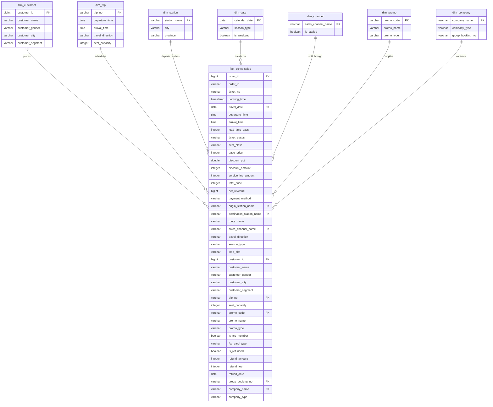

# High-Speed Train (HST) Analytics Mart & DWBI Guide

A denormalized, production-grade analytics dataset designed for **Data Warehousing & Business Intelligence (DWBI)** courses, academic capstone projects (Tugas Besar / Tubes), executive reporting, and predictive analytics.

The **HST Analytics Wide Mart** (`v0.3.0`) transforms 17 relational OLTP tables across 6 operational years (2020–2025) into a unified, high-performance dimensional dataset of **10,815,864 ticket transactions**.

---

## 1. Overview & Architecture

### Star Schema Architecture

In classic Kimball dimensional modeling, business processes are modeled as star schemas with centralized fact tables and surrounding dimension tables. The HST Analytics dataset materializes this star schema into an optimized wide denormalized table while preserving pure star schema compatibility:



---

## 2. Data Dictionary

The wide dataset exposes **43 granular attributes** spanning transactional facts, degenerate dimensions, joined entity dimensions, and precomputed analytical features.

| Column Name | SQL Type | DW Role | Nullable | Business Description | Example Value |
|---|---|---|---|---|---|
| `ticket_id` | `BIGINT` | Primary Key | No | Unique surrogate ticket transaction identifier | `414` |
| `order_id` | `VARCHAR` | Degenerate Dim | No | Commercial booking order number grouping transactions | `'O60000008484'` |
| `ticket_no` | `VARCHAR` | Degenerate Dim | No | Printed physical/digital boarding pass serial number | `'T340000007038'` |
| `booking_time` | `TIMESTAMP` | Temporal Dim | No | Exact transaction timestamp when reservation was created | `2020-01-01 00:00:00` |
| `travel_date` | `DATE` | Temporal Dim | No | Scheduled train departure date | `2020-01-01` |
| `departure_time` | `TIME` | Temporal Dim | No | Scheduled departure time from origin station | `09:05:00` |
| `arrival_time` | `TIME` | Temporal Dim | No | Scheduled arrival time at destination station | `09:52:00` |
| `lead_time_days` | `INTEGER` | Measure / Metric | No | Booking lead time in days (`travel_date - booking_date`) | `0` |
| `ticket_status` | `VARCHAR` | Dimension | No | Final lifecycle state of ticket (`used`, `refunded`, `cancelled`) | `'used'` |
| `seat_class` | `VARCHAR` | Dimension | No | Service cabin class (`economy`, `premium`, `business`, `first`) | `'economy'` |
| `base_price` | `INTEGER` | Fact Measure | No | Standard catalog list fare in Indonesian Rupiah (IDR) | `200000` |
| `discount_pct` | `DOUBLE` | Fact Measure | No | Discount percentage applied (0.0 to 100.0) | `10.0` |
| `discount_amount` | `INTEGER` | Fact Measure | No | Total discount deductions in IDR | `20000` |
| `service_fee_amount` | `INTEGER` | Fact Measure | No | Channel convenience surcharge in IDR | `0` |
| `total_price` | `INTEGER` | Fact Measure | No | Gross billed price paid by customer before refunds | `180000` |
| `net_revenue` | `BIGINT` | Fact Measure | No | Realized operator revenue (`total_price - refund_amount`) | `180000` |
| `payment_method` | `VARCHAR` | Dimension | No | Settlement instrument (`debit_card`, `fcc_quota`, `qris`, etc.) | `'fcc_quota'` |
| `origin_station_name` | `VARCHAR` | Dimension | No | Origin station name (`Halim`, `Karawang`, `Padalarang`, `Tegalluar`) | `'Tegalluar'` |
| `destination_station_name` | `VARCHAR` | Dimension | No | Destination station name | `'Halim'` |
| `route_name` | `VARCHAR` | Dimension | No | High-speed line route name | `'Jakarta - Bandung'` |
| `sales_channel_name` | `VARCHAR` | Dimension | No | Distribution channel (`Counter`, `App`, `Web`, `Agent`, `FCC`, `Group`) | `'FCC'` |
| `travel_direction` | `VARCHAR` | Derived Dim | No | Train transit orientation (`outbound` east vs `inbound` west) | `'inbound'` |
| `season_type` | `VARCHAR` | Derived Dim | No | Calendar seasonality segment (Lebaran, Nataru, School, Covid, Normal) | `'nataru'` |
| `time_slot` | `VARCHAR` | Derived Dim | No | Operating diurnal slot (`morning_commute`, `afternoon`, `evening_commute`, `night`) | `'afternoon'` |
| `customer_id` | `BIGINT` | Dimension Key | No | Unique synthetic passenger entity identifier | `31` |
| `customer_name` | `VARCHAR` | Dimension | Yes | Full synthetic passenger name | `'Ganjaran Laswi Susanti'` |
| `customer_gender` | `VARCHAR(1)` | Dimension | Yes | Passenger gender (`M` / `F`) | `'M'` |
| `customer_city` | `VARCHAR` | Dimension | Yes | Domicile city of passenger | `'Bandung'` |
| `customer_segment` | `VARCHAR` | Ground Truth | Yes | True behavioural persona (`commuter`, `business`, `leisure`, `infrequent`) | `'commuter'` |
| `trip_no` | `VARCHAR` | Dimension | No | Scheduled train service number | `'HST102'` |
| `seat_capacity` | `INTEGER` | Dimension | No | Train physical passenger capacity (600 seats) | `600` |
| `promo_code` | `VARCHAR` | Dimension | Yes | Promotional campaign identifier if applied | `'HST-MEMBER-2020'` |
| `promo_name` | `VARCHAR` | Dimension | Yes | Marketing campaign title | `'HST Member Fare 2020'` |
| `promo_type` | `VARCHAR` | Dimension | Yes | Promotion classification (`loyalty`, `holiday`, `flash_sale`, etc.) | `'loyalty'` |
| `is_fcc_member` | `BOOLEAN` | Derived Flag | No | Whether ticket was issued against an active Frequent Customer Card | `true` |
| `fcc_card_type` | `VARCHAR` | Dimension | Yes | Card membership tier (`G` Gold - 10 quota, `S` Silver - 6 quota) | `'S'` |
| `is_refunded` | `BOOLEAN` | Derived Flag | No | Ticket cancellation and refund flag | `false` |
| `refund_amount` | `INTEGER` | Fact Measure | Yes | Payout disbursed back to passenger upon cancellation (IDR) | `NULL` |
| `refund_fee` | `INTEGER` | Fact Measure | Yes | Cancellation penalty fee retained by operator (IDR) | `NULL` |
| `refund_date` | `DATE` | Temporal Dim | Yes | Date cancellation and refund was processed | `NULL` |
| `group_booking_no` | `VARCHAR` | Dimension | Yes | Corporate group contract number (BAK) if group travel | `NULL` |
| `company_name` | `VARCHAR` | Dimension | Yes | Client corporate / educational / governmental institution name | `NULL` |
| `company_type` | `VARCHAR` | Dimension | Yes | Organization classification (`corporate`, `school`, `agency`, etc.) | `NULL` |

---

## 3. Practical DWBI Use-Cases & SQL Queries

All queries below can be executed directly on `hst_analytics_wide_v0.3.0.parquet` using DuckDB or imported into PostgreSQL, BigQuery, Snowflake, or ClickHouse.

### Use-Case 1: Diurnal Load Factor & Capacity Utilization

**Objective**: Determine hourly train load factors across morning and evening peak commute windows to optimize timetable scheduling and rolling stock allocations.

```sql
SELECT 
    time_slot,
    travel_direction,
    COUNT(*) AS total_passengers,
    COUNT(DISTINCT trip_no || travel_date) AS total_trips_run,
    ROUND(COUNT(*)::DOUBLE / (COUNT(DISTINCT trip_no || travel_date) * 600) * 100, 2) AS avg_load_factor_pct,
    ROUND(SUM(net_revenue) / 1e9, 2) AS net_revenue_billion_idr
FROM read_parquet('hst_analytics_wide_v0.3.0.parquet')
WHERE travel_date >= '2023-01-01' -- Mature operating regime
  AND ticket_status = 'used'
GROUP BY 1, 2
ORDER BY 2, 5 DESC;
```

**Analytical Insight**: Morning outbound (`Halim -> Bandung`) and evening inbound (`Bandung -> Halim`) demonstrate peak commuter concentrations with load factors regularly exceeding 85%, compared to off-peak afternoon frequencies (~55%).

---

### Use-Case 2: Customer Recency, Frequency & Monetary (RFM) Segmentation

**Objective**: Aggregate passenger transactional histories to classify customer value tiers, identify churn risks, and validate behavioural clustering models against ground-truth segments.

```sql
WITH customer_rfm AS (
    SELECT 
        customer_id,
        customer_segment,
        MAX(travel_date) AS last_travel_date,
        DATE_DIFF('day', MAX(travel_date), DATE '2025-12-31') AS recency_days,
        COUNT(*) AS trip_frequency,
        SUM(net_revenue) AS monetary_value_idr
    FROM read_parquet('hst_analytics_wide_v0.3.0.parquet')
    WHERE ticket_status = 'used'
    GROUP BY 1, 2
)
SELECT 
    customer_segment,
    COUNT(*) AS total_customers,
    ROUND(AVG(recency_days), 1) AS avg_recency_days,
    ROUND(AVG(trip_frequency), 1) AS avg_trips_per_customer,
    ROUND(AVG(monetary_value_idr), 0) AS avg_monetary_spend_idr,
    ROUND(SUM(monetary_value_idr) / 1e9, 2) AS total_segment_revenue_billion_idr
FROM customer_rfm
GROUP BY 1
ORDER BY total_segment_revenue_billion_idr DESC;
```

**Analytical Insight**: The `commuter` segment accounts for over 45% of total operating passenger volume with high frequency (20+ trips/year) and short recency (< 14 days), whereas `leisure` travelers show high seasonal monetary spikes during holiday windows.

---

### Use-Case 3: Lebaran Mudik vs. Balik Directional Asymmetry

**Objective**: Quantify structural passenger flow imbalances during major national holiday migrations (Idul Fitri) to plan dynamic ticket pricing and empty-run train positioning.

```sql
SELECT 
    EXTRACT(year FROM travel_date) AS operating_year,
    season_type,
    travel_direction,
    COUNT(*) AS total_passengers,
    ROUND(SUM(total_price) / 1e9, 2) AS gross_revenue_billion_idr,
    ROUND(AVG(lead_time_days), 1) AS avg_booking_lead_time_days
FROM read_parquet('hst_analytics_wide_v0.3.0.parquet')
WHERE season_type IN ('lebaran_mudik', 'lebaran_balik')
GROUP BY 1, 2, 3
ORDER BY 1, 2, 3;
```

**Analytical Insight**: During `lebaran_mudik` (H-7 to H-0), outbound traffic to Bandung/West Java dominates by up to 3.8x inbound traffic. The reverse occurs during `lebaran_balik` (H+1 to H+7). Booking lead times during Lebaran peak at 21–28 days versus a normal baseline of 2–4 days.

---

### Use-Case 4: Refund Risk & Cancellation Velocity by Sales Channel

**Objective**: Assess ticket cancellation rates, refund payout exposure, and cancellation timing across sales channels to optimize liquidity reserves and cancellation fee policies.

```sql
SELECT 
    sales_channel_name,
    COUNT(*) AS total_tickets_sold,
    COUNT(*) FILTER (WHERE is_refunded) AS refunded_tickets,
    ROUND(COUNT(*) FILTER (WHERE is_refunded)::DOUBLE / COUNT(*) * 100, 2) AS refund_rate_pct,
    ROUND(SUM(refund_amount) / 1e9, 2) AS total_refund_payout_billion_idr,
    ROUND(SUM(refund_fee) / 1e9, 2) AS retained_penalty_revenue_billion_idr,
    ROUND(AVG(lead_time_days) FILTER (WHERE is_refunded), 1) AS avg_cancelled_lead_time_days
FROM read_parquet('hst_analytics_wide_v0.3.0.parquet')
GROUP BY 1
ORDER BY refund_rate_pct DESC;
```

**Analytical Insight**: Self-service channels (`App` and `Web`) have higher cancellation rates (~2.1%) due to lower barrier-to-purchase, while `Counter` and `Agent` channels show lower refund rates (< 0.9%) but higher retained penalties.

---

### Use-Case 5: Promotional Campaign Elasticity & Net Revenue Contribution

**Objective**: Measure the incremental impact of marketing discounts, comparing gross discounted volume against net profit margins across seat classes.

```sql
SELECT 
    COALESCE(promo_name, 'No Promotion (Standard Catalog)') AS promotion,
    seat_class,
    COUNT(*) AS tickets_issued,
    ROUND(AVG(discount_pct), 1) AS avg_discount_pct,
    ROUND(SUM(discount_amount) / 1e9, 2) AS total_discounts_granted_billion_idr,
    ROUND(SUM(net_revenue) / 1e9, 2) AS net_revenue_billion_idr,
    ROUND(AVG(net_revenue), 0) AS yield_per_ticket_idr
FROM read_parquet('hst_analytics_wide_v0.3.0.parquet')
GROUP BY 1, 2
ORDER BY tickets_issued DESC
LIMIT 15;
```

**Analytical Insight**: Loyalty discounts (FCC member fares) sustain high-margin repeat commuter volume in Economy and Premium cabins without cannibalizing Business or First class yield.

---

## 4. BI Dashboard & Visualization Playbook

### Connecting with Power BI / Tableau / Metabase

1. **Direct Parquet Connection**:
   - Modern BI platforms (Power BI via DuckDB ODBC, Tableau via Hyper/Parquet, Metabase via ClickHouse or DuckDB driver) can query `hst_analytics_wide_v0.3.0.parquet` directly with sub-second response times.
2. **PostgreSQL / DuckDB Server**:
   - Spin up a local DuckDB server or load into PostgreSQL schemas `oltp` and `oltp_truth` using `scripts/load_db.py`.
3. **Recommended Visualizations**:
   - **Line Chart with Dual Axis**: Monthly Net Revenue (IDR) vs. Passenger Volume over time (2020–2025).
   - **Heatmap Matrix**: Departure Hour (06:00 to 20:00) vs. Day of Week showing Load Factor percentage.
   - **Sankey Diagram**: Origin Station -> Sales Channel -> Cabin Seat Class -> Destination Station.
   - **Waterfall Chart**: Catalog Base Price -> Discounts Granted -> Cancellation Refunds -> Realized Net Revenue.
